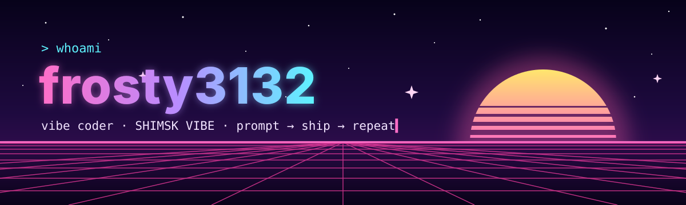
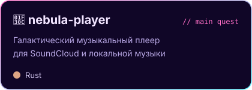

<div align="center">



<a href="https://github.com/frosty3132">
  
</a>

<p>
  
  
  
  
</p>

</div>

<br/>

<h2 align="center">✦ whoami</h2>

<div align="center">
  
</div>

<br/>

<h2 align="center">⚡ vibe stack</h2>

<div align="center">
  
  <br/><br/>
  <sub><i>языки меняются — вайб остаётся</i></sub>
</div>

<br/>

<h2 align="center">🎧 currently vibing on</h2>

<div align="center">
  <a href="https://github.com/frosty3132/nebula-player"></a>
</div>

<br/>

<h2 align="center">📜 vibe coding manifesto</h2>

```diff
+ 01. сначала вайб, потом архитектура
+ 02. промпт — это тоже код
+ 03. работает? коммить. не работает? перепромпть
+ 04. лучший рефакторинг — это `git push` и новый день
+ 05. ошибка в консоли — просто ещё один промпт
+ 06. лоуфай в наушниках обязателен
- 07. читать документацию целиком
- 08. дебажить в 4 утра без музыки
- 09. забывать трогать траву
```

<br/>

<h2 align="center">📊 vibe metrics</h2>

<div align="center">
  
  <br/><br/>
  
</div>

<br/>

<div align="center">
  
</div>


